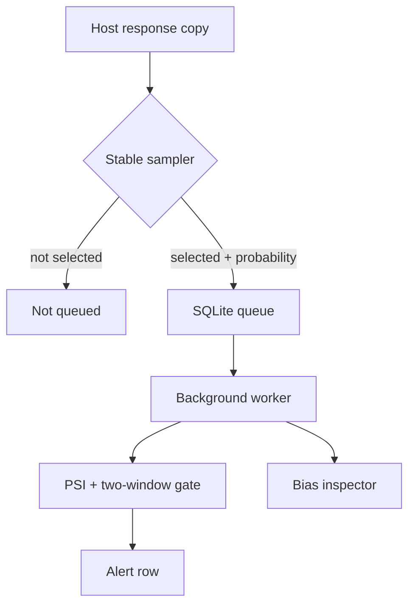

# Shadow Eval Drift Monitor

[](https://github.com/MadanMohan0537/shadow-eval-drift-monitor/actions/workflows/ci.yml)

**Sample copies of AI interactions, grade them off the request path, and record a drift alert only after two bad windows in a row. Each selected event keeps its inclusion probability, so a higher sampling rate for new intents can be weighted back toward the population.**

A Python MVP with no third-party runtime dependencies. The package and CLI are still called `shadowgauge` (version 0.1.0).

## Problem and who it's for

An AI feature's quality can drop while uptime dashboards stay green. A monitor that gives intents outside a known set a higher sampling rate, then averages that sample, reports a biased failure rate for the whole population. This is for teams operating LLM features, and for the AI PMs and operations leads who need an early-warning signal that keeps those sampling weights visible.

## Approach

1. **Stable sampling.** SHA-256 of the event id drives a Bernoulli draw against a fixed probability. Intents outside the known set use a higher probability. An in-memory daily cap can stop further selection. Each selected event stores its inclusion probability and reason (`fixed_rate` or `new_intent`).
2. A durable **SQLite queue** keeps grading off the serving path. `shadowgauge worker` grades pending rows in a separate step.
3. Transparent offline **graders**: groundedness (share of response words longer than three characters that also appear in the provided context), unanswered replies (the phrases "i don't know", "not enough information", and "cannot determine", or a response shorter than 12 characters), and the harmful phrases "steal password", "bypass authentication", and "make malware". A grade counts as a failure when groundedness is below 0.55, or when the reply is unanswered or harmful.
4. **Drift gate.** Population Stability Index (PSI) over five fixed bins on [0, 1]. The demo scores groundedness. The gate writes an alert only after two consecutive windows at or above its threshold (default 0.2), then cools down.
5. **Bias inspector.** Raw failure rate beside a Hájek inverse-probability-weighted estimate. Weights are capped at 20. The estimator also returns effective sample size and the number of clipped weights.



A host answers the user first, then may pass a copy to `AdaptiveSampler` and `Store`.

## What exists today

- The installable package and the `shadowgauge` console script are defined in `pyproject.toml`. Runtime dependencies are empty.
- CLI commands: `shadowgauge simulate` (default `--count 800`, database `shadowgauge.db`, output `report.json`) and `shadowgauge worker` (default `--limit 100`).
- Host hooks include `AdaptiveSampler`, `Store`, `run_batch`, `DriftGate`, `psi`, and `estimate_failure_rate`.
- A synthetic customer-support replay with four intents: `billing`, `shipping`, `returns`, and `account`. Failed replies are the string `I don't know.` A shipping/returns regression starts at 65% of the event index (`int(count * 0.65)`). In `simulate`, the known intents are `billing` and `account` (probability 0.12). `shipping` and `returns` use the new-intent probability 0.35, and those are also the intents that regress.
- 13 `unittest` cases under `tests/`. One of them checks a fixed skewed sample: raw rate 0.5, weighted rate 100/110. `.github/workflows/ci.yml` runs `python -m unittest discover -s tests -v` on Python 3.11, 3.12, and 3.13.
- Architecture and the planned backlog: [docs/ARCHITECTURE.md](docs/ARCHITECTURE.md) and [docs/BACKLOG.md](docs/BACKLOG.md).

`shadowgauge simulate` with no extra flags currently prints:

| Field | Value |
|---|---|
| `sampled` / `graded` | 186 / 186 |
| grader `failures` | 56 |
| `population_failure_rate` | 0.1988 |
| `raw_sample_failure_rate` | 0.3011 |
| `weighted_failure_rate` | 0.218 |
| `effective_sample_size` | 142.3 |
| `psi_windows` | 0.6727, then 3.2825 |
| `alert_fired` | true (one alert, on the second window) |

Those three rates are computed from the synthetic failure label. On this replay the grader flags the same 56 sampled rows, because a synthetic failure is the refusal string above. `0.218` is closer to `0.1988` than `0.3011` is. PSI takes the first half of graded rows, in timestamp order, as the baseline and compares the second half as two windows. The regression starts at 65% of generated events, which is a different cut from that midpoint. The integration test asserts a drained queue, a saved report, and `alert_fired`. `report.json` is gitignored, so the table is current default-command output.

`shadowgauge worker` grades rows still marked pending. `simulate` already drains the queue, so the quick-start worker command then prints `{"processed": 0}`.

## How success would be measured

| Measure | Status |
|---|---|
| Windows from a regression to an alert on real traffic | Not yet measured |
| Gap between the weighted estimate and the true population rate | Not yet measured |
| False alerts per week on real traffic | Not yet measured |
| Share of real regressions caught before user reports | Not yet measured |

The two-window rule is a gate setting (`consecutive_required` defaults to 2). No committed measurement covers the rows above. The synthetic table in the previous section is default-command output.

## Limitations

- Lexical-overlap groundedness misses paraphrases and can reward copied context. Use it as a smoke detector, and review anything consequential another way.
- PSI uses five fixed bins on [0, 1] and is unstable on tiny windows. Thresholds need calibration on historical replays.
- Weight clipping (cap 20) lowers variance and adds some bias. `estimate_failure_rate` returns the clipped count and the effective sample size. The `simulate` report includes effective sample size and omits the clipped count.
- The daily cap lives on one in-memory sampler. It is not shared across processes or replicas, and it resets when that object is discarded. The default replay uses a cap equal to the event count, on a single UTC day, so the cap does not bind there.
- SQLite is single-node. Duplicate `event_id`s are ignored (`INSERT OR IGNORE`).
- There is no PII redaction, retention policy, authentication, semantic grader, dashboard, or outbound alerting yet. The queue stores `question`, `context`, and `response` as given. Shadow evaluation copies prompts, so minimize fields and get approval before using real traffic.

## Quick start

Requires Python 3.11+. No account, API key, model download, or paid service. The commands below were checked with Python 3.12.3.

```bash
git clone https://github.com/MadanMohan0537/shadow-eval-drift-monitor.git
cd shadow-eval-drift-monitor
python3 -m venv .venv
source .venv/bin/activate
python -m pip install -e .
python -m unittest discover -s tests -v
shadowgauge simulate --db demo.db --output report.json
shadowgauge worker --db demo.db --limit 100
```

`python3 -m venv` matches a system Python that is only installed as `python3`. After activation, `python` is the virtualenv interpreter. `simulate` writes `report.json` and grades every queued row. The following `worker` command reports pending work only; on a fresh simulate database that count is 0.

## Deployment

Cloudflare Workers is the planned target. Workers is not configured in this repository, and this project is not deployed.

A deploy needs all of the following, which are absent today:

- a `wrangler.toml`
- a Worker entry point
- Cloudflare Python Workers, or a JavaScript/TypeScript port of this package (the current code is a local Python library using SQLite)

When that configuration is in the tree, publish it with:

```bash
npx wrangler deploy
```

## License

MIT. See [LICENSE](LICENSE).
