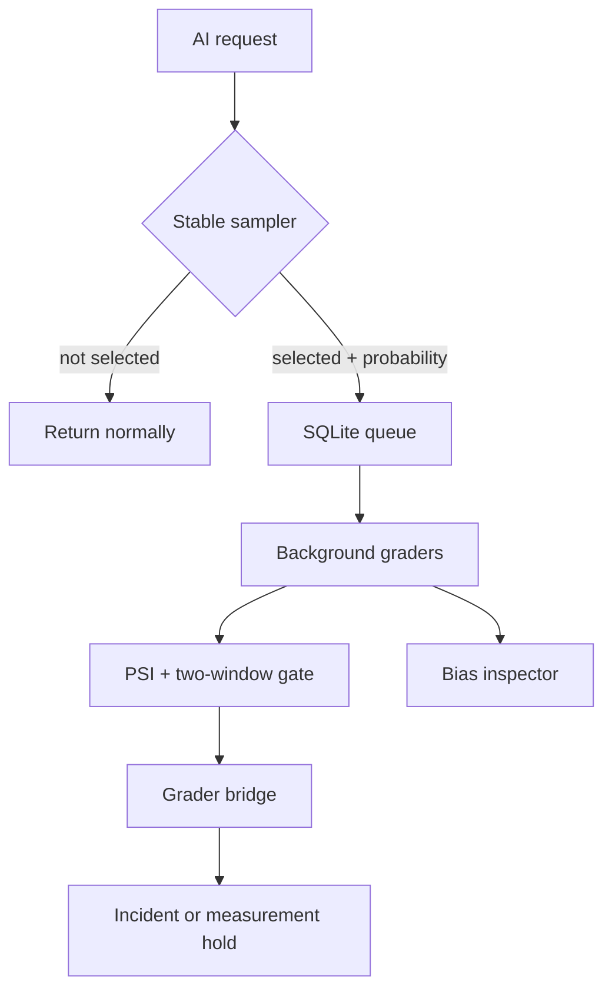

# ShadowGauge

[](https://github.com/MadanMohan0537/shadowgauge/actions/workflows/ci.yml)

ShadowGauge quietly samples live AI interactions, grades copies off the request path, and raises a drift incident only after two bad windows. Its bias inspector records every sample's inclusion probability, then reports raw and inverse-probability-weighted failure rates side by side—so aggressively sampling a new intent does not get mistaken for population quality.

> **Project Lab traceability:** project 03, originally “Hidden-Eval Canary.” ShadowGauge is the product name; this note prevents the renamed idea from being built twice.

## Why this exists

Online AI quality can regress while uptime remains green. A naive monitor can make the situation worse: it oversamples unfamiliar traffic, averages the sample, and reports a biased population rate. ShadowGauge makes the sampling contract observable and checks both quality drift and estimator health.

## What works today

- Stable hash-based sampling at a fixed rate, with explicit oversampling for new intents.
- A daily sample cap and a stored inclusion probability/reason for every selected event.
- A durable SQLite queue that keeps grading away from the serving path.
- Auditable groundedness, unanswered-question, and harmful-phrase graders.
- Population Stability Index (PSI) drift checks with a two-window confirmation gate and cooldown.
- **Sampling-bias inspector (P1 extension):** raw rate, Hájek inverse-probability estimate, capped weights, and effective sample size.
- **Grader-version bridge (P2 extension):** dual-grade a frozen overlap, enforce per-intent coverage, and quarantine measurement shifts before incident creation.
- Deterministic synthetic replay that injects a regression and produces a machine-readable report.
- Unit/integration tests and a Python 3.11–3.13 GitHub Actions matrix.

Outbound Slack/email delivery, semantic model graders, and a browser dashboard remain backlog items—not completed features.

## Quick start

No account, API key, model download, or paid service is required.

```bash
python -m venv .venv
source .venv/bin/activate
python -m pip install -e .
shadowgauge simulate --db demo.db --output report.json
cat report.json
```

To grade a batch previously placed in the SQLite queue:

```bash
shadowgauge worker --db demo.db --limit 100
shadowgauge bridge-demo --output bridge-report.json
```

Run the test suite:

```bash
python -m unittest discover -s tests -v
```

## Core flow



`AdaptiveSampler` uses SHA-256 of the event ID, so the same replay gives the same selection. New intents can receive a higher probability. `Store` persists the probability alongside the copied request, and `run_batch` grades pending records. `estimate_failure_rate` uses inverse-probability weights, capped to limit variance, and exposes effective sample size (ESS). `DriftGate` requires consecutive breaches and adds a cooldown to reduce alert storms. Before switching graders, `analyze_bridge` compares paired old/new scores and `classify_product_drift` refuses to label an incompatible measurement change as a product incident.

## Reproducible evidence

The checked-in generator creates synthetic customer-support traffic with four intents. It introduces a shipping/returns regression after 65% of the replay. The integration test asserts that the queue drains, the report is saved, and the conservative alert fires.

The bias estimator is tested against a deliberately skewed sample: the raw rate is 50%, while weighting recovers the known population mix (about 90.9%). This small fixture tests the estimator's behavior; it is not a claim about real model quality.

The bridge demo double-grades 24 frozen synthetic events across four intents. A seeded
grader-only score shift produces PSI 27.631, but the bridge quarantines it and emits
`MEASUREMENT_HOLD` rather than a product incident. The compatible control permits a
seeded application regression to emit `PRODUCT_INCIDENT`. These deterministic fixtures
prove attribution control flow, not real-grader stability.

## Configuration and integration

This MVP exposes Python seams instead of a production proxy:

```python
from shadowgauge.sampling import AdaptiveSampler
from shadowgauge.store import Store

sampler = AdaptiveSampler(
    base_rate=0.05,
    new_intent_rate=0.35,
    known_intents={"billing", "shipping"},
    daily_cap=500,
)
decision = sampler.decide(event["event_id"], event["intent"], event["ts"][:10])
if decision.included:
    Store("shadowgauge.db").enqueue(event, decision.probability, decision.reason)
```

Call this after producing the user-visible response. Never place raw secrets or regulated data in `question`, `context`, or `response`; the current MVP has no redaction layer.

## Metrics to watch

| Metric | What it answers | Current output |
|---|---|---|
| Time to detection | How many evaluation windows pass after a regression? | Two by design |
| Intent coverage | Which traffic groups are represented? | Stored per event; aggregate UI is planned |
| Grader share | How much traffic is graded? | Sampled/total can be derived by the host |
| Raw vs weighted rate | Is adaptive sampling biasing the headline? | `report.json` |
| Effective sample size | Are a few large weights dominating? | `report.json` |
| PSI | Did the score distribution move? | Per evaluated window |
| Bridge mean/flip shift | Did the measurement system change? | Overall and per intent |

## Limitations

- Lexical overlap is explainable and offline, but it misses paraphrases and can reward copied context. It is a smoke detector, not a factuality oracle.
- PSI uses fixed score bins and is unstable on tiny windows. Real deployments should set minimum segment counts and calibrate thresholds on historical replays.
- Weight clipping trades lower variance for some estimator bias. ShadowGauge reports clipped count and ESS so operators can see that tradeoff.
- The process-local daily cap is not coordinated across replicas. A production sampler needs an atomic shared budget.
- SQLite is appropriate for a portfolio-scale single-node MVP, not high-throughput multi-writer serving.
- Synthetic labels prove mechanics, not external validity. Human adjudication remains necessary before consequential decisions.
- Frozen overlap coverage may miss new or rare intents. Compatibility thresholds require calibration on real repeated grades, and quarantine delays product monitoring until the measurement change is resolved.
- There is no authentication, PII scrubbing, retention policy, semantic grader, hosted dashboard, or outbound alert integration yet.

## Responsible use

Shadow evaluation can copy sensitive prompts. Minimize fields before enqueueing, set a retention window, restrict database access, and obtain appropriate user/legal approval. Treat grader flags as review signals. Do not automatically penalize users, employees, or vendors from these scores.

## Roadmap

The prioritized, testable backlog—including the grader-version bridge and newly brainstormed extensions—is in [docs/BACKLOG.md](docs/BACKLOG.md). Architecture and operating assumptions are in [docs/ARCHITECTURE.md](docs/ARCHITECTURE.md).

## Repository map

```text
shadowgauge/
  sampling.py     deterministic decisions + weighted estimator
  grading.py      transparent offline graders
  store.py        SQLite queue, grades, and incidents
  monitoring.py   PSI and alert gate
  bridge.py       grader overlap validation, segment checks, incident attribution
  simulation.py   reproducible synthetic traffic
  cli.py          simulate and worker commands
tests/             unit and end-to-end checks
docs/              architecture and rigorous backlog
```

## License

MIT

